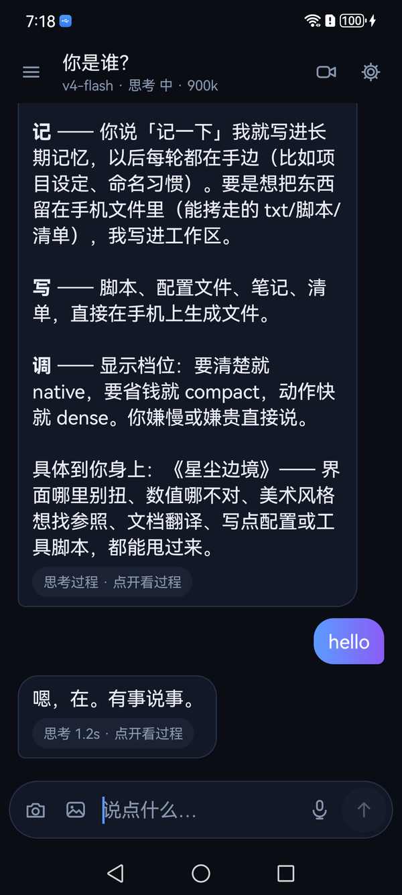
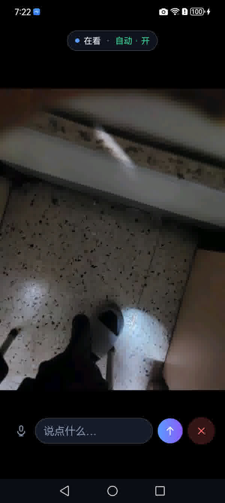
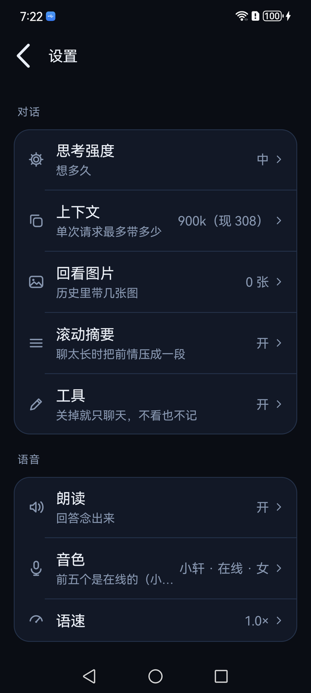
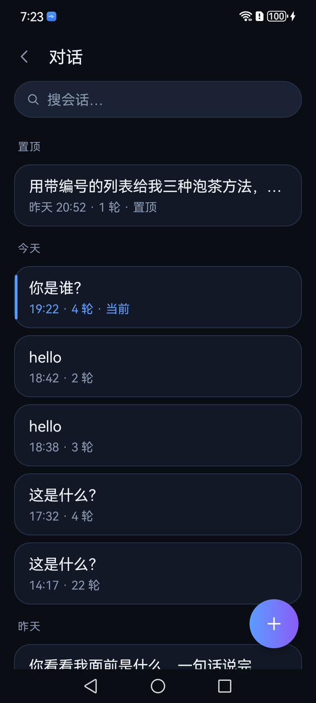
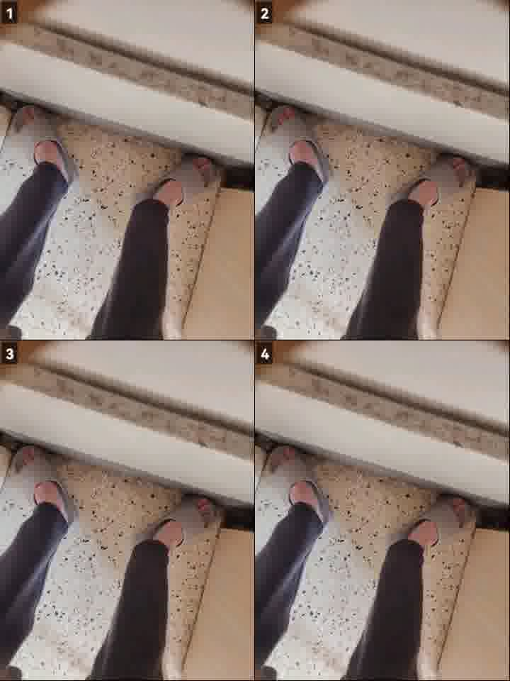
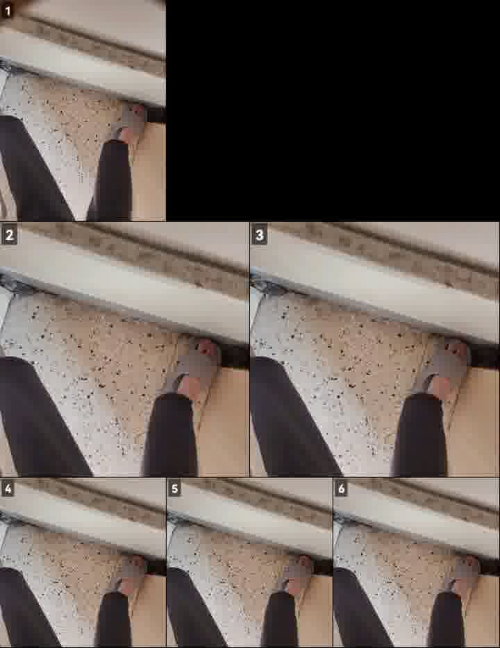
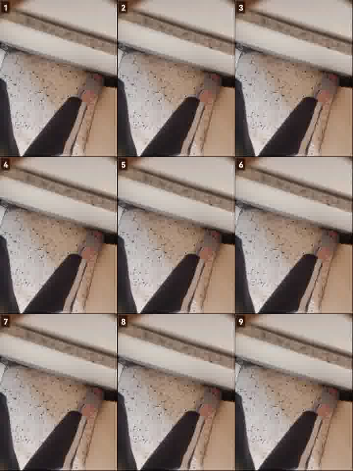
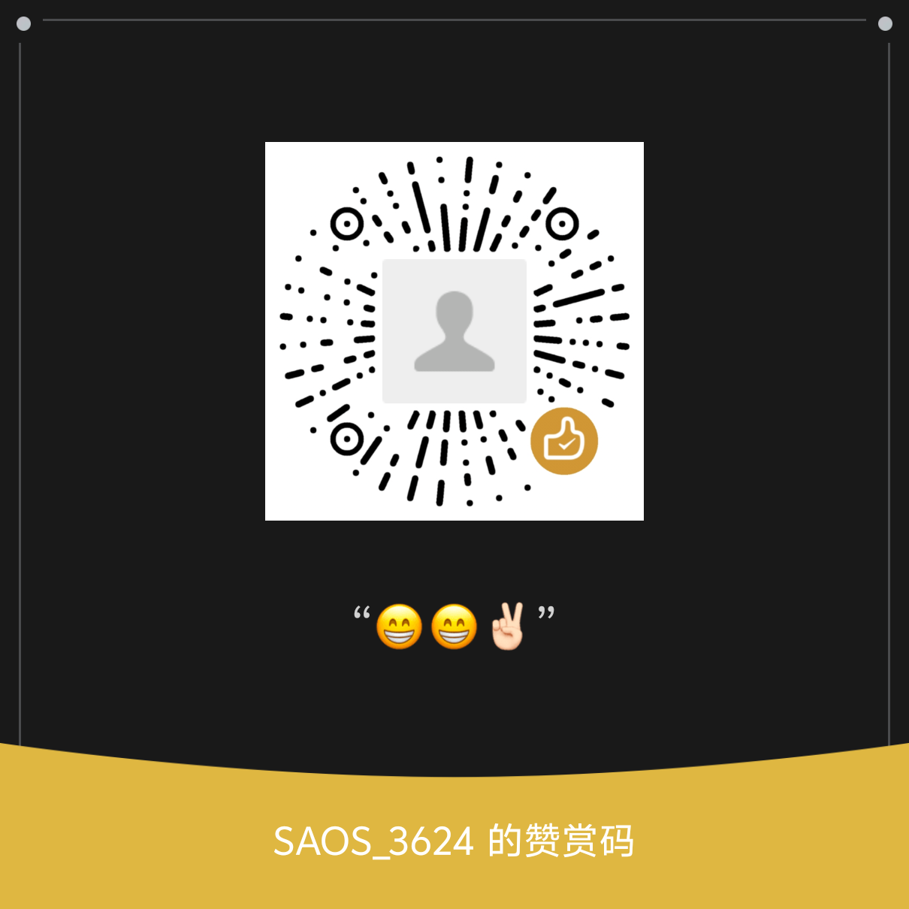

<div align="center">


# 鱼眼 · See on Phone

**让 AI 住进手机 —— 在手机上聊天，需要时自己看世界。**

一个 Android App + 一个电脑插件，同一个仓库，同一份 Apache-2.0。

[](LICENSE)
[](#-自己编译)
[](CREDITS.md)

[它是什么](#-它是什么) · [装哪个](#-装哪个) · [App](#-鱼眼-app) · [插件](#-电脑插件-dsh-see-on-phone) · [出处与署名](CREDITS.md) · [许可](LICENSE)

</div>

---

> **English, briefly.** *See on Phone* puts an AI agent **on** the phone instead of on a server:
> a self-contained Android chat app that can open the camera, fold several frames into one
> contact sheet, remember things, write files, speak, and listen — no PC required. A companion
> Node plugin lets a desktop agent borrow the same camera. Blind navigation is **one optional
> mode**, not the product.

## 🐟 它是什么

**鱼眼是一个能自己看东西的 AI 聊天 App。** 你打字或说话，模型需要知道"眼前有什么"时，
自己调用 `look` 打开摄像头、看 1~8 秒、把几帧拼成一张宫格、然后回答你。
不需要电脑、不需要上传视频流、不需要装 ffmpeg。

它同时还能：**听**（语音输入）、**说**（系统 TTS）、**记**（跨会话记忆）、
**写文件**（自己的一个工作区目录）、**搬会话**（和桌面 DSH 互通）。

电脑上的插件 `dsh-see-on-phone` 是另一半：让**桌面上的 agent** 借手机的眼睛看一眼，
一张 JPEG 回来 —— 屏幕里看不到你桌上的杯子。

### 三条设计取向（决定了它长成现在这样）

| 取向 | 具体做法 |
|---|---|
| **端上跑，不绕服务器** | 模型 API 你自己填；画面在手机本地拼成一张 `471×628` 的宫格（4~7 KB）再发出去。没有中转、没有统计 |
| **相机是工具，不是取景器** | 只有 `look` 被调用时借相机，没人要 3 秒后自动关。想自己看画面进"通话页" |
| **导盲只是读者之一** | `normal`（你看得见，它给你细节）和 `guide`（你看不见，它只给结论和动作）是**同一个模型的两个提示词**，不是两套代码。**它不是辅具**，见 [NOTICE](NOTICE) |

## 📦 装哪个

仓库的 [Releases](https://github.com/SAOS-3624/see-on-phone/releases) 里每次都放**两个文件**，
按你需要挑：

| 你想要 | 下这个 | 还需要 |
|---|---|---|
| 手机上有个能聊天、能看东西的 AI | `see-on-phone-<ver>.apk` | 一个 OpenAI 兼容的 API Key |
| 让电脑上的 agent 借手机的眼睛 | `dsh-see-on-phone-<ver>.tgz` | **必须先装上面那个 APK**（手机就是服务端） |
| 两个都要 | 两个都下 | 同上 |

> **不需要新仓库，也不需要两个仓库。** App 和插件是一个产品的两端，版本一起发、契约一起改，
> 分开放只会让"插件 0.4 配 App 0.29"这种错配变成常态。Release 用两个资产区分就够了。

## 🐠 鱼眼 App


### 能干什么

- **聊天**：流式输出、Markdown 渲染、思考过程可折叠、上下文预算可调（2k~900k）
- **看**：`look` 工具 —— 开相机 → 采样 → 挑帧 → 拼宫格 → 交给模型。宫格是**按镜头切换点**排的，
  动得多的帧给大格子，静止的给一条；不是平均切九宫格
- **听**：系统语音识别，单句输入
- **说**：用系统 TTS。装一个语音引擎（讯飞 / 搜狗 / Google TTS / 厂商自带）就能有
  多种音色，装了什么设置里就能选什么。**我们不自己联网合成** —— 原因见[出处](#-出处与署名)
- **记**：`memory_read` / `memory_write`，跨会话；每轮自动带上
- **写**：`files` 工具，一块固定工作区 `Download/DSH-Go/workspace/` —— 文件管理器里能直接看到、拷走、删
  （目录名沿用 `DSH-Go`，这样老版本的会话、记忆、日志原地还能用，不用迁移）
- **搬**：会话与记忆的摊平导出/增量导入，和桌面 `phone-bridge` 对得上
- **给别人看**：内置 HTTP 服务（`127.0.0.1:4444`），电脑插件靠它工作

### 界面

| 会话页 | 通话页 | 设置 | 对话 |
|---|---|---|---|
| 消息流 + 输入栏 + 工具状态 | 实时预览 + 字幕（离开就还相机） | 分组卡片，二十来项配置一页到底 | 置顶 / 今天 / 更早，搜索和新建 |

<p align="center">




</p>

> 截图是实机（华为，1084×2412）跑的 1.0.0，没有修饰。

### 它看到的是什么

**不是平均切的九宫格。** 先算逐帧变化分 → 找镜头切点 → 按切点密度分档 →
行 DP 装箱：动得多的帧给大格子，没动的给一条。所以一张图里信息量是**被分配过**的。

<p align="center">



</p>

一张 `471×628` 的 JPEG，**4~7 KB**，约 **197 token**。

### 装法

```bash
# 1. 从 Releases 下 APK，然后
adb install -r see-on-phone-<ver>.apk

# 2. 打开「鱼眼」→ 右上角齿轮 → 填接口和 Key
#    接口：https://api.deepseek.com/v1        （任何 OpenAI 兼容端点都行）
#    模型：deepseek-chat
```

第一次点"看"会申请相机权限。**装在应用商店之外**（sideload），系统会提示风险，正常。

### 自己编译

不需要 Gradle，不需要 Android Studio。只要 **JDK 17** + 一份 `android.jar` + 四个 jar（d8 / aapt2 / apksigner / lib）：

```bash
export ANDROID_SDK=/path/to/android-sdk     # 里面有 android.jar 和 build-tools
bash app/build.sh                            # 6 步：javac → d8 → aapt2 compile → link → 塞 dex → 签名
```

产物 `app/see-on-phone.apk`，约 220 KB（图标是 WebP）。构建细节与踩过的坑：[`app/docs/BUILD.md`](app/docs/BUILD.md)。

<details>
<summary><b>为什么 targetSdk 是 29（而不是 34）</b></summary>

- ≤ 28 会被新系统弹"此应用是针对旧版 Android 打造的"，OPPO/小米上都见过；
- ≥ 30 强制分区存储，`Download/鱼眼/` 下的工作区文件就写不进去，得改成 SAF 或申请全盘权限；
- Android 12 的后台启动限制只管 targetSdk ≥ 31 的 App，而它要开机自启；
- sideload 没有 Play 的 targetSdk 门槛，所以 29 没有代价。

</details>

## 🖥 电脑插件 `dsh-see-on-phone`

```bash
npm i -g dsh-see-on-phone      # 或者从 Release 里的 .tgz 装
```

模型调用 `see_phone` → 插件 HTTP 打手机 `/look` → 手机自己采、自己挑、自己拼 → **一张 JPEG** 回来。
**电脑这边不抽帧、不装 ffmpeg、不拉原始流。**

| action | 干什么 | 等待 |
|---|---|---|
| `look`（默认） | 抓一张宫格 | 手机采集 1~2 秒（`wait` 可调 0.5~8） |
| `watch` | 看"这一会儿发生了什么" | 默认 8 秒 |
| `peek` | 最快的一张 | 1 秒 |
| `status` | 手机状态（相机/上下文/思考/朗读） | — |
| `stop` | 停语音（相机归手机自己关） | — |

`mode:"normal"`（默认，用户看得见画面）或 `mode:"guide"`（导盲：只给结论和动作）。
配置只有两项，在 `~/.dsh/see-phone.json`：`url` 和 `mode` —— 档位、节奏、前后摄像头**都在手机 App 里**，
两个地方各存一份配置最后一定会打架。

```bash
node scripts/doctor.mjs      # 手机通不通、语音播放有没有
node scripts/smoke.mjs 6     # 拍 6 秒存成 jpg，自己看
```

## 🧭 出处与署名

拼图那套（切点检测 → 档位 → 行 DP 装箱 → 拼图 → token 换算）最初写在
[`dsh-see-now`](https://github.com/SAOS-3624/dsh-see-now) 和
[`dsh-video-storyboard`](https://github.com/SAOS-3624/dsh-video-storyboard) 里，
App 里这份是**同一套算法的 Java 逐行移植**（同作者，同许可），曾经逐字节对拍过。

切点那套的**思想来源**是 [PySceneDetect](https://github.com/Breakthrough/PySceneDetect)（BSD-3）的
`ContentDetector`：把 HSV 三通道的差异加权成一个变化分。它用 OpenCV 在原始分辨率上算，
我们在 64×36 网格上手写 —— 取的是结论，没有读它的源码。

### 为什么没有「在线音色」

App 1.x 内置过 5 个 Edge 在线音色（小轩 / 晓晓 / 晓伊 / 云希 / 云扬），要自己算 `Sec-MS-GEC` 令牌。
那套算法当时是**照着 [edge-tts](https://github.com/rany2/edge-tts) 的 Python 实现一位一位搬成 Java 的** ——
把一份实现翻译成另一种语言，在著作权上就是演绎作品，那两个文件受 **GPL-3.0** 约束，
连同一个 APK 里的 Apache-2.0 代码也会被一起拖进去。

**2.0 起整条链路删掉了**（852 行），换成"你自己装引擎"。功能没有消失，只是不再由我们替你联网合成。
拿到 1.3.x 及更早 APK 的人，请按 GPL-3.0 使用 —— 具体说明在 [CREDITS §5.1](CREDITS.md)。

当前代码树**没有任何第三方源码**。逐条见 **[CREDITS.md](CREDITS.md)**。

## ⚖️ 许可

[Apache-2.0](LICENSE)。拿去商用、改名、闭源分发都可以，保留版权与许可声明即可。

许可全文跟着二进制走：npm 包里有 `LICENSE` / `NOTICE` / `CREDITS.md`；
APK 里打进 `res/raw/`，手机上「设置 → 关于 → 许可」能直接看。

**但它不是辅具。** 这个 App 会把画面变成文字描述，它**会看错、会延迟、会在暗处失灵**。
过马路、上下楼梯、避障 —— 用白杖、用导盲犬、用无障碍设施。详见 [NOTICE](NOTICE)。

---

## ☕ 打赏

**不影响上面任何一个字**：代码是 Apache-2.0，不收费、不需要授权、不搞"打赏才给好功能"。
觉得它替你省了时间，就扫下面这个码请我喝杯咖啡 —— 纯自愿，不给也照样能用全部功能。

<p align="center">
  
</p>

